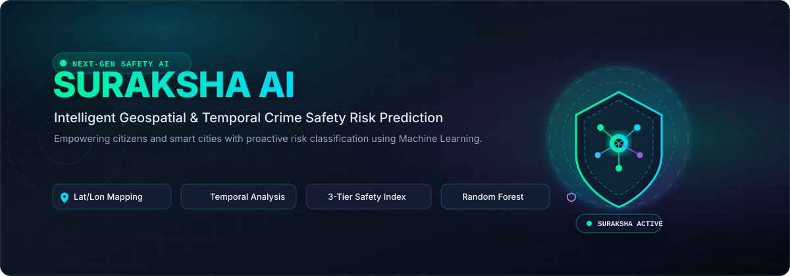
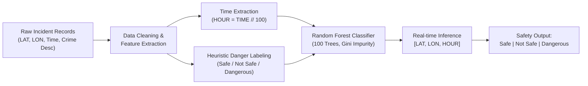

<p align="center">
  
</p>

<p align="center">
  <strong>Suraksha AI</strong> (सुरक्षा AI) is an intelligent machine learning safety system designed to predict geospatial and temporal crime vulnerability, empowering proactive personal safety and smart city route assessment.
</p>

<p align="center">
  <a href="https://github.com/RITAM-DAWN237/SURAKHSA_AI/stargazers"></a>
  <a href="https://github.com/RITAM-DAWN237/SURAKHSA_AI/network/members"></a>
  <a href="https://github.com/RITAM-DAWN237/SURAKHSA_AI/issues"></a>
  <a href="https://github.com/RITAM-DAWN237/SURAKHSA_AI/blob/main/LICENSE"></a>
  <a href="https://colab.research.google.com/drive/1ucnMpLlGx_5GEVnQZ4GMW0f2bvHWxLCT"></a>
</p>

<p align="center">
  
  
  
  
  
</p>

---

## 📌 Table of Contents

- [Overview](#-overview)
- [Key Features](#-key-features)
- [How It Works](#-how-it-works)
- [Risk Classification Index](#-risk-classification-index)
- [Dataset](#-dataset)
- [Project Architecture](#-project-architecture)
- [Getting Started](#-getting-started)
  - [Prerequisites](#prerequisites)
  - [Installation](#installation)
- [Usage & Sample Prediction](#-usage--sample-prediction)
- [Model Evaluation](#-model-evaluation)
- [Real-World Applications](#-real-world-applications)
- [Roadmap](#-roadmap)
- [Contributing](#-contributing)
- [License](#-license)
- [Author & Acknowledgments](#-author--acknowledgments)

---

## 🌟 Overview

Personal safety during late-night travel or unfamiliar commutes is a critical challenge. **Suraksha AI** (*"Suraksha"* meaning *Protection/Safety*) leverages predictive machine learning models trained on large-scale urban crime records to assess situational risk based on:

1. **Latitude (`LAT`)** — Spatial coordinate.
2. **Longitude (`LON`)** — Spatial coordinate.
3. **Time of Day (`HOUR`)** — Hour of day (0 to 23) extracted from occurrence timestamps.

By processing spatial hotspots and historical temporal patterns, the model predicts a multi-level risk classification (`Safe`, `Not Safe`, or `Dangerous`) to guide users toward safer routing decisions.

---

## 🚀 Key Features

- **🌐 Geospatial Risk Profiling:** Maps continuous geographical coordinates (`LAT`, `LON`) to historical incident concentrations.
- **🕒 Temporal Pattern Recognition:** Discretizes 24-hour timestamps to capture nocturnal crime spikes and low-risk day cycles.
- **🛡️ 3-Tier Granular Threat Index:** Employs an intelligent tiered mapping system prioritizing severe interpersonal offenses.
- **⚡ Fast Inference:** Utilizes a lightweight, optimized `RandomForestClassifier` ready for integration into mobile apps or edge navigation systems.
- **📓 Cloud & Local Ready:** Run directly through Jupyter / Google Colab or as a standalone Python utility script.

---

## 🧠 How It Works

Suraksha AI implements a clean end-to-end data and modeling pipeline:



---

## 🛡️ Risk Classification Index

Crimes are dynamically assigned threat scores based on severity:

| Level | Classification | Associated Incident Profiles | Actionable Guidance |
| :---: | :--- | :--- | :--- |
| **0** | <span style="color:#10B981; font-weight:bold;">Safe</span> | Property damage, petty theft, minor non-violent incidents | Normal vigilance; generally secure area |
| **1** | <span style="color:#F59E0B; font-weight:bold;">Not Safe</span> | Robbery, simple assault, battery, harassment | High alert; avoid unlit routes, prefer company |
| **2** | <span style="color:#EF4444; font-weight:bold;">Dangerous</span> | Homicide, rape, aggravated assault with deadly weapon, kidnapping | High danger zone; re-route immediately or seek police assistance |

---

## 📊 Dataset

The model utilizes extensive urban crime records (e.g., Los Angeles Metropolitan Crime Open Data):
- **Records Analyzed:** ~1,000,000+ incident entries
- **Extracted Features:**
  - `LAT`: Geographical Latitude
  - `LON`: Geographical Longitude
  - `HOUR`: Converted hour of incident (24-hour cycle)
  - `Crm Cd Desc`: Detailed police crime description

---

## 📂 Project Architecture

```plaintext
SURAKHSA_AI/
│
├── assets/
│   └── banner.svg               # Vector SVG project header banner
│
├── suraksha_ai.py               # Standalone Python script with full pipeline
├── Suraksha_Ai.ipynb            # Google Colab / Jupyter interactive notebook
├── requirements.txt             # Python dependencies
├── .gitignore                   # Git ignore configurations
└── README.md                    # Project documentation
```

---

## 💻 Getting Started

### Prerequisites

- Python 3.8 or above
- `pip` package manager

### Installation

1. **Clone the repository:**
   ```bash
   git clone https://github.com/RITAM-DAWN237/SURAKHSA_AI.git
   cd SURAKHSA_AI
   ```

2. **Create a virtual environment (recommended):**
   ```bash
   python -m venv venv
   # On Windows:
   venv\Scripts\activate
   # On macOS/Linux:
   source venv/bin/activate
   ```

3. **Install dependencies:**
   ```bash
   pip install -r requirements.txt
   ```

---

## ⚡ Usage & Sample Prediction

Run the interactive notebook or execute inference directly in Python:

```python
import numpy as np
from sklearn.ensemble import RandomForestClassifier

# Sample Input: Downtown location at 7:00 PM (19:00 hours)
# Format: [Latitude, Longitude, Hour (0-23)]
sample_location = [[34.0407, -118.2468, 19]]

# Predict danger class
prediction = model.predict(sample_location)
labels = ['Safe', 'Not Safe', 'Dangerous']

print(f"Safety Status: {labels[prediction[0]]}")
# Output: Safety Status: Not Safe
```

### Run via Command Line

```bash
python suraksha_ai.py
```

Or open directly in Google Colab:
[](https://colab.research.google.com/drive/1ucnMpLlGx_5GEVnQZ4GMW0f2bvHWxLCT)

---

## 🎯 Model Evaluation

The model was validated using an 80/20 train-test split:

- **Algorithm:** Random Forest Classifier (`n_estimators=100`, `random_state=42`)
- **Evaluation Metric:** Multi-class Classification Accuracy
- **Test Set Accuracy:** **`~73.14%`**

> [!NOTE]
> Performance reflects real-world urban crime distribution complexity. Future releases will introduce geographical clustering (K-Means/DBSCAN) and hyperparameter tuning to further improve precision on rare violent crime instances.

---

## 🌍 Real-World Applications

- **👩 Women & Student Safety Applications:** Integrated into personal safety apps for safer commute timing and travel companions.
- **🗺️ Navigation Overlays:** Smart navigation routing that avoids high-danger density clusters during night hours.
- **🚔 Predictive City Policing:** Assisting civic authorities in dynamic patrol allocation based on time-sensitive hotspot predictions.
- **🚕 Ride-sharing & Delivery Safety:** Warning drivers and gig workers before accepting trips to high-vulnerability drop-offs after dark.

---

## 🛣️ Roadmap

- [x] Baseline Random Forest spatial-temporal classification pipeline
- [x] Colab and script implementations
- [ ] Add interactive heatmap visualization using `Folium` / `Leaflet.js`
- [ ] Build a lightweight Streamlit / FastAPI web application
- [ ] Incorporate real-time SOS alerting & safe-haven routing (nearest police stations/hospitals)
- [ ] Train XGBoost and Deep Learning (LSTM) temporal architectures for sequence forecasting

---

## 🤝 Contributing

Contributions make the open-source community thrive! Any contributions you make are **greatly appreciated**.

1. Fork the Project
2. Create your Feature Branch (`git checkout -b feature/AmazingFeature`)
3. Commit your Changes (`git commit -m 'Add some AmazingFeature'`)
4. Push to the Branch (`git push origin feature/AmazingFeature`)
5. Open a Pull Request

---

## 📜 License

Distributed under the **MIT License**. See `LICENSE` for more information.

---

## 👤 Author & Acknowledgments

**Ritam Dawn**  
- GitHub: [@RITAM-DAWN237](https://github.com/RITAM-DAWN237)
- Repository: [SURAKHSA_AI](https://github.com/RITAM-DAWN237/SURAKHSA_AI)

*Developed with the vision of utilizing artificial intelligence to create safer communities.*
